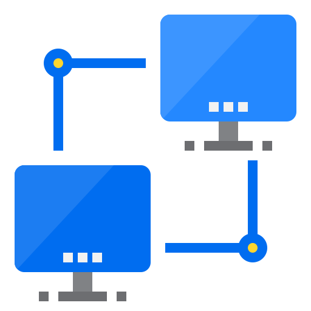
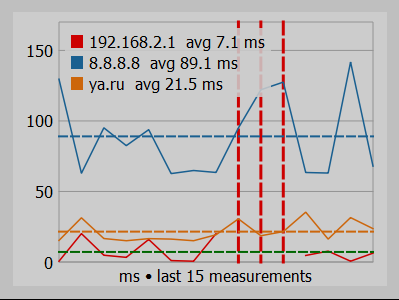
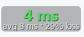

<div align="center">



# PingMonitor

**A lightweight, cross-platform ping monitor with a live graph, alerts and a tiny click-through overlay.**

[](https://github.com/GVCoder09/PingMonitor/actions/workflows/ci.yml)
[](https://github.com/GVCoder09/PingMonitor/releases)
[](https://github.com/GVCoder09/PingMonitor/releases)
[](https://github.com/GVCoder09/PingMonitor/releases)
[](LICENSE)

[](https://github.com/GVCoder09/PingMonitor/stargazers)
[](https://github.com/GVCoder09/PingMonitor/network/members)
[](https://github.com/GVCoder09/PingMonitor/issues)
[](https://github.com/GVCoder09/PingMonitor/commits/main)
[](https://github.com/GVCoder09/PingMonitor)
[](CONTRIBUTING.md)

[](pyproject.toml)
[](#installation)
[](https://riverbankcomputing.com/software/pyqt/)
[](https://docs.astral.sh/ruff/)
[](tests)

[Features](#features) ·
[Installation](#installation) ·
[Usage](#usage) ·
[FAQ](#faq) ·
[Contributing](CONTRIBUTING.md)


</div>

## Why PingMonitor?

Is it my Wi-Fi, my ISP or the server? PingMonitor answers that at a glance. Leave
it running in a corner of the screen, or shrink it to a small indicator that
stays on top of your game, call or stream and never gets in the way of the mouse.

- **Several hosts at once**, each with its own colour, graph line and statistics.
- **Never freezes**: checks and pings run in background threads.
- **Tells you when something breaks** with tray notifications.
- **Remembers everything**: hosts, settings and the overlay position.
- **One small codebase** (Python + PyQt5), MIT licensed, no telemetry, no accounts.

## Features

| | |
|---|---|
| **Live graph** | Last N measurements per host, a dashed mean line, red markers for lost packets and an optional alert-threshold line. |
| **Multi-host** | Up to 8 hosts, comma-separated. Unreachable hosts are reported and skipped. |
| **Rich statistics** | Sent, received, loss, min, avg, max, **jitter**, **median** and **95th percentile** per host. |
| **Alerts** | Notification when a host stops answering (3 lost packets in a row), comes back, or exceeds your latency threshold. Repeats are throttled (one per host and kind per minute) and everything can be switched off with the **Notifications** checkbox. The tray icon shows a red badge while something is wrong. |
| **Three modes** | Full window, compact always-on-top window, and a click-through mini overlay. |
| **Export** | Full history to CSV, graph to PNG. |
| **Tunable ping** | TTL, timeout, packet size and interval, changed on the fly. |
| **Persistent** | Everything is saved between runs. |

### Three ways to look at it

<table>
  <tr>
    <td align="center" valign="middle" width="50%">
      <br>
      <b>Compact mode</b> (<code>Ctrl+W</code>)<br>
      <sub>Frameless, always on top, 80% opaque, draggable.</sub>
    </td>
    <td align="center" valign="middle" width="50%">
      <br>
      <b>Mini mode</b> (<code>Ctrl+E</code>)<br>
      <sub>Latest latency, average and loss. Mouse clicks pass through it.</sub>
    </td>
  </tr>
</table>

The mini overlay can't receive input, so it is controlled from the **system tray
icon**: restore the window, switch modes, **move** the overlay (its position is
remembered), pick its **opacity**, or quit. The tray tooltip lists the latest
result of every host.

## Installation

<details open>
<summary><b>Standalone executable (no Python needed)</b></summary>

Download the archive for your platform from the
[Releases](https://github.com/GVCoder09/PingMonitor/releases) page, unpack it and
run `PingMonitor`.

</details>

<details>
<summary><b>With pip</b> (Python 3.9+)</summary>

```bash
pip install git+https://github.com/GVCoder09/PingMonitor.git
pingmonitor
```

</details>

<details>
<summary><b>From source</b></summary>

```bash
git clone https://github.com/GVCoder09/PingMonitor.git
cd PingMonitor
pip install -e .
python -m pingmonitor
```

</details>

## Usage

1. Type one or more hosts, separated by commas, for example `8.8.8.8, 1.1.1.1, example.com`.
2. Press **Start**. New hosts are checked in the background first.
3. Switch to **Compact** or **Mini** mode when you want it out of the way.

### Settings

| Field | Meaning | Default |
|---|---|---|
| Hosts | Hosts to ping (up to 8, comma-separated) | `8.8.8.8` |
| TTL | IP time-to-live of the packets | 56 |
| Timeout (s) | How long to wait before a packet counts as lost | 3 |
| Packet size | Payload size in bytes | 32 |
| Interval (s) | Time between two pings of the same host | 1 |
| Graph points | Measurements shown on the graph | 15 |
| Alert above (ms) | Notify when latency exceeds this value; `0` disables | 0 |
| Notifications | Show alerts as tray notifications (the red badge on the tray icon stays) | on |

TTL, timeout, size and interval apply immediately, without restarting. Changing
the hosts needs **Apply** (or **Start**).

### Keyboard shortcuts

| Shortcut | Action |
|---|---|
| `Ctrl+W` | Toggle compact mode |
| `Ctrl+E` | Mini mode |
| `Ctrl+Q` | Quit |

### Exported CSV

```csv
timestamp,host,latency_ms,status
2026-10-15T19:42:01.250+03:00,8.8.8.8,23.871,ok
2026-10-15T19:42:03.251+03:00,example.com,,lost
```

## FAQ

<details>
<summary><b>Pinging fails with an error on Linux</b></summary>

ICMP needs privileges on Linux. Run the program as root or allow unprivileged
ICMP sockets:

```bash
sudo sysctl -w net.ipv4.ping_group_range="0 2147483647"
```

On Windows and macOS a regular user is enough. If pinging is not allowed, the
application shows an error message instead of failing silently.

</details>

<details>
<summary><b>Where are my settings stored?</b></summary>

With Qt's `QSettings` under "PingMonitor": the registry
(`HKEY_CURRENT_USER\Software\PingMonitor`) on Windows, a plist on macOS and
`~/.config/PingMonitor/PingMonitor.conf` on Linux.

</details>

<details>
<summary><b>The mini mode button is disabled</b></summary>

The mini overlay is controlled from the system tray, so it needs one. Some
desktop environments (for example GNOME without an extension) don't provide it.

</details>

<details>
<summary><b>How is it different from PingPlotter, WinMTR, gping or vmPing?</b></summary>

PingMonitor is a small desktop *latency* monitor, not a route analyser.

| | Platforms | Graph | Many hosts | Per-hop route | Overlay | Free |
|---|---|---|---|---|---|---|
| **PingMonitor** | Win / macOS / Linux | yes | yes | no | yes | yes |
| [PingPlotter](https://www.pingplotter.com/) | Win / macOS | yes | paid | yes | no | limited |
| [WinMTR](https://sourceforge.net/projects/winmtr/) | Windows | no | no | yes | no | yes |
| [gping](https://github.com/orf/gping) | Win / macOS / Linux | terminal | yes | no | no | yes |
| [vmPing](https://github.com/R-Smith/vmPing) | Windows | no | yes | no | no | yes |

If you need to know *which hop* loses packets, use PingPlotter or WinMTR. If you
want a quick, always-visible indicator of your connection quality, use this.

</details>

## Development

```bash
git clone https://github.com/GVCoder09/PingMonitor.git
cd PingMonitor
pip install -e ".[dev]"
ruff format . && ruff check . && pytest
```

Build a standalone executable locally:

```bash
pip install -e ".[build]"
pyinstaller packaging/pingmonitor.spec --noconfirm
```

<details>
<summary><b>Project layout</b></summary>

```
src/pingmonitor/
├── __main__.py      # entry point
├── settings.py      # PingSettings, AppConfig, host parsing
├── store.py         # SettingsStore: persistence via QSettings
├── stats.py         # PingStats: counters, jitter, percentiles
├── history.py       # HistoryLog: all measurements, CSV export
├── alerts.py        # AlertTracker: down / up / slow detection
├── monitor.py       # ping threads (PingWorker, PingMonitor)
├── hostcheck.py     # HostChecker: background reachability checks
├── resources/       # application icon
└── ui/              # windows and widgets
packaging/           # PyInstaller entry script and spec
tests/
```

</details>

## Contributing

Bug reports and pull requests are welcome, see [CONTRIBUTING.md](CONTRIBUTING.md).

If PingMonitor is useful to you, consider giving it a star on GitHub.

## License

[MIT](LICENSE) © GVCoder09
